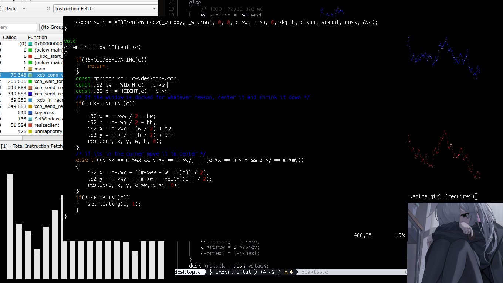

# vox-wm
The [vox-wm](https://github.com/DerjenigeUberMensch/vox-wm/) project was intially a mission to create a window manager that could offer the same usability that a regular desktop while being simple to the end user.

While still maintaing the window manager like feel of multiple different layouts and simpled nature behaviour.

## Preview (Monocle)


## Table of Contents
1. [Requirements](#requirements)
2. [Usage](#usage)
3. [Compiling](#compiling)
4. [Uninstalling](#uninstalling)
5. [How to Run](#how-to-run)
6. [Mousebinds](#mousebinds)
7. [Keybinds](#keybinds)
8. [Troubleshoot](#troubleshoot)

<a name="headers"/>

## Early Release
This build is ***not*** fully feature ready.

## Why Use this.
- **Low Memory Usage under (~10 MiB) (When compiled in Release Mode)**
- **Low CPU usage (~.1-2%) idle**
- **Low CPU usage when doing expensive stuff (mapping windows) (~3-7%)**

## Why Not Use this.
- **Doesnt use C++**
- **XCB**

## Requirements
### Base (Required)
- **gcc or clang**
- **make**
- **git**
- **dmenu**
- **st**
- **xorg**
- **xorg-xinit**
- **libxcb**
- **xcb-proto**
- **xcb-util**
- **xcb-util-errors**
- **xcb-util-cursor**
- **xcb-util-image**
- **xcb-util-keysyms**
- **xcb-util-wm**
- **xcb-util-xrm**
### Multi Media Key Support. (Optional)
- **PulseAudio**
- **Playerctl**
- **Brightnessctl**

## Pacman && yay
### Base (Required)
```
sudo pacman -S --needed gcc make git dmenu xorg xorg-xinit libxcb xcb-util xcb-util-errors xcb-util-cursor xcb-util-image xcb-util-keysyms xcb-util-wm xcb-util-xrm lua && yay -S st
```
### Multi Media (Optional)
```
sudo pacman -S --needed playerctl brightnessctl
```

## Usage
To **use** the wm you must first **compile it**.
Afterwards you must put `exec vox-wm` in your `~/.xinitrc` file. **See Below.**

## Compiling
1. Clone this repository.
```
git clone https://github.com/DerjenigeUberMensch/vox-wm.git
```
2. Change Directory to vox-wm.
```
cd vox-wm
```
3. Download required libraries.
```
sudo pacman -S --needed gcc make git dmenu xorg xorg-xinit libxcb xcb-util xcb-util-errors xcb-util-cursor xcb-util-image xcb-util-keysyms xcb-util-wm xcb-util-xrm lua && yay -S st
```
4. Configure it See **[Configuration](#configuration)** (Optional)
5. Compile using Make
```
make
```
6. Install on system, install location '/usr/local/bin'
```
sudo make install
```
7. Done.

## Uninstalling
1. Change Directory to vox-wm.
```
cd vox-wm
```
2. Uninstall using Make
```
sudo make uninstall
```

## How to Run
1. Compile, See [Compiling](#compiling).
2. Choose option(s) below.
3. Locate binary
    - if installed should be **"vox-wm"**
    - else should be located under **"bin/release/"** folder as **"vox-wm"**
4. For customization and helpful tips see [Configuration](#configuration)

### Normal Usage
4. Put **"exec YOUR_BINARY_LOCATION"** in **~/.xinitrc** or similiar XServer configuration.
    - if it doesnt work make sure that no window-manager/desktop manager is run before.

### Xephyr (Debug/Testing Usage)
4. Start a Xephyr server.
    - Example: `Xephyr :1 -ac c 25 +xinerama -resizeable -screen 680x480 &`
5. After locating the binary location make sure you are in the correct display server.
    - Example: `export DISPLAY=:1`
6. After setting the correct external xserver display variable simply run the binary file.
    - Example: `./bin/release/vox-wm` or `vox-wm`

## Configuration

### Recommendations for running alongside of vox-wm
alttab   (Task switcher)

numlockx (Numlock key on)

feh      (Background)

### Keybinds and context menus as of this version are currently locked to manually setting via compilation.
If you know a bit of C you can change dmenu colours and some keybinds under the directory `vox-wm/src/keybind/keybinds.c` *`WMKeybindInit()`* and `vox-wm/include/legacy/keybinds.h`

### Config

config support is under `~/.config/vox-wm/vox.cfg`

all settings (that have worked) have been supported since v2

> **NOTE:** `inf` represents the maximum value supported by the underlying integer type, not actual infinity. Values exceeding this limit will produce a configuration error.

|           Setting             |  Type  |      Range       |     Default      |                                                                        Description                                                                             |
| ----------------------------- | ------ | ---------------- | ---------------- | -------------------------------------------------------------------------------------------------------------------------------------------------------------- |
| MFact                         | number |    0.0 - 1.0     |       0.55       | Space of main window (left) during Tiled mode in decimal percentage.                                                                                           |
| GapRatio                      | number |    0.0 - 1.0     |       0.95       | Space for all windows to NOT use when in Tiled mode around window borders                                                                                      |
| MCount                        | number |     0  - inf     |        1         | Number of main windows (left) during Tiled mode (MUST BE WHOLE NUMBER)                                                                                         |
| Snap                          | number |     0  - inf     |        15        | Number of pixels before a window snaps to the desktop when dragging (MUST BE WHOLE NUMBER)                                                                     |
| RefreshRate                   | number |    0.0 - inf     |        60        | MAX number of resize requests sent when resizing a window in FPS; 0 to disable. (MUST BE WHOLE NUMBER)                                                         |
| SmartResizing                 |  bool  |   true / false   |       true       | Lowers window slightly due to imperfect human eye to make windows feel more centered; false to disable.                                                        |
| CenteringBias                 | number |   0.0 - 0.0825   |       .0125      | Center bias offset in decimal percentage; see above.                                                                                                           |
| HoverFocus                    |  bool  |   true / false   |       false      | Switch focus when hovering over a window; false to disable.                                                                                                    |
| UseDecorations                |  bool  |   true / false   |       false      | ? This Setting is not Officially Supported and may not work ?                                                                                                  |
| UseClientSideDecorations      |  bool  |   true / false   |       true       | Enable use of client side decorations. (This setting must be set at the start of the X session); false to disable.                                             |
| PreferClientSideDecorations   |  bool  |   true / false   |       true       | ? This Setting only works when UseDecorations is enabled ?                                                                                                     |
| UseLegacyFloatingSystem       |  bool  |   true / false   |       false      | Enables the use of the legacy floating system, this is meant as a fallback and is deprecated; false to disable.                                                |
| UseAutomaticBarGeometry       |  bool  |   true / false   |       true       | Enables the use of automatic geometry quering and resizing for supported windows; false to disable                                                             |
| BarLX                         | number |    0.0 - 1.0     |       0.00       | Horizontal position of the left bar relative to the screen width in decimal percentage.                                                                        |
| BarLY                         | number |    0.0 - 1.0     |       0.00       | Vertical position of the left bar relative to the screen height in decimal percentage.                                                                         |
| BarLW                         | number |    0.0 - 1.0     |       0.15       | Width of the left bar relative to the screen width in decimal percentage.                                                                                      |
| BarLH                         | number |    0.0 - 1.0     |       1.00       | Height of the left bar relative to the screen height in decimal percentage.                                                                                    |
| BarRX                         | number |    0.0 - 1.0     |       0.85       | Horizontal position of the right bar relative to the screen width in decimal percentage.                                                                       |
| BarRY                         | number |    0.0 - 1.0     |       0.00       | Vertical position of the right bar relative to the screen height in decimal percentage.                                                                        |
| BarRW                         | number |    0.0 - 1.0     |       0.15       | Width of the right bar relative to the screen width in decimal percentage.                                                                                     |
| BarRH                         | number |    0.0 - 1.0     |       1.00       | Height of the right bar relative to the screen height in decimal percentage.                                                                                   |
| BarTX                         | number |    0.0 - 1.0     |       0.00       | Horizontal position of the top bar relative to the screen width in decimal percentage.                                                                         |
| BarTY                         | number |    0.0 - 1.0     |       0.00       | Vertical position of the top bar relative to the screen height in decimal percentage.                                                                          |
| BarTW                         | number |    0.0 - 1.0     |       1.00       | Width of the top bar relative to the screen width in decimal percentage.                                                                                       |
| BarTH                         | number |    0.0 - 1.0     |       0.15       | Height of the top bar relative to the screen height in decimal percentage.                                                                                     |
| BarBX                         | number |    0.0 - 1.0     |       0.00       | Horizontal position of the bottom bar relative to the screen width in decimal percentage.                                                                      |
| BarBY                         | number |    0.0 - 1.0     |       0.85       | Vertical position of the bottom bar relative to the screen height in decimal percentage.                                                                       |
| BarBW                         | number |    0.0 - 1.0     |       1.00       | Width of the bottom bar relative to the screen width in decimal percentage.                                                                                    |
| BarBH                         | number |    0.0 - 1.0     |       0.15       | Height of the bottom bar relative to the screen height in decimal percentage.                                                                                  |

### Startup

startup program support is under `~/.config/vox-wm/startup.cfg`

There is no syntax highlighting nor comment support in this startup file, as it is ***HIGHLY*** recommened to just use this as a alias for running a seperate shell script for example just putting ./my_shell_script.sh and just putting all the startup stuff you want in my_shell_script.sh.

For a example startup file you may check out this one [here](https://github.com/DerjenigeUberMensch/dot_files/blob/main/.config/vox-wm/startup.sh)

## Mousebinds
These are the default mousebinds currently used within vox-wm, they are not planned to change (defaults), but will be when or if a configuration is implemented.

- RMB: Right Mouse Button.
- LMB: Left Mouse Button.
- MMB: Middle Mouse Button.

| Button | Action |
| ------ | ------ |
| SUPER+RMB | Activates Window Resizing of the Clicked Window. (Must be Held) |
| SUPER+ALT+RMB | See above, does not apply ANY window restrictions, these include: minimum size, maximimum size, base size, inc size, etc... |
| SUPER+LMB | Activates Window Moving of the Clicked Window. (Must be Held) |

## Keybinds
These are the default keybinds currently used within vox-wm, they are not currently planned to change, but will be when or if a configuration is implemented.

- SUPER: The "Windows" key (next to fn/ctrl, usually the left side of the keyboard).
- RETURN: The Enter key (Right above right SHIFT, Not the numlock Enter key)

| Key | Action |
| ----- | ----- |
| SUPER+n | Debug/Unused |
| SUPER+d | exec dmenu |
| SUPER+RETURN | exec st |
| SUPER+e | exec thunar |
| SUPER+b | Hide/Show Task bar (if applicable) |
| SUPER+SHIFT+q | Exit Current Window |
| CTRL+ALT+q | Terminate Current Window |
| SUPER+w | Maximize Current Window |
| SUPER+SHIFT+p | Quit (exit window manager) |
| SUPER+CTRL+p | Soft Restart |
| CTRL+ALT+p | Hard Restart |
| SUPER+CTRL+z | Make the current Window Sticky |
| SUPER+z | Change Layout To Tiling |
| SUPER+x | Change Layout To Floating |
| SUPER+c | Change Layout To Monocle |
| SUPER+g | Change Layout To Grid |
| SUPER+1 | Set Current Desktop To 1 |
| SUPER+2 | Set Current Desktop To 2 |
| SUPER+3 | Set Current Desktop To 3 |
| SUPER+4 | Set Current Desktop To 4 |
| SUPER+5 | Set Current Desktop To 5 |
| SUPER+6 | Set Current Desktop To 6 |
| SUPER+7 | Set Current Desktop To 7 |
| SUPER+8 | Set Current Desktop To 8 |
| SUPER+9 | Set Current Desktop To 9 |
| SUPER+0 | Set Current Desktop To 10 |

### Base Calls
These are actions that expected supporting basic keyboard support.
| Key | Action |
| ----- | ----- |
| F11 | Fullscreen On The Current Window |
| Increase Volume | Increase Volume Controls |
| Decrease Volume | Decrease Volume Controls |
| Increase Brightness | Increase Brightness Controls |
| Decrease Brightness | Decrease Brightness Controls |
| Mute | Sound Mute Functionality |
| Play | Inverts Playing Status (play-pause) |
| Pause |  Inverts Playing Status (play-pause) |
| Next | Next Audio Playback |
| Prev | Previous Audio Playback |


## Troubleshoot
This is an **_experimental_** build and may contain bugs,
Screen tearing can be mitigated by using a compositor or by enabling it in your driver setting

If you have any **major** **issues** with the **current** commit you can **revert** to a **previous commit** for a generally stabler version.
Or you can open an **[issue](https://github.com/DerjenigeUberMensch/vox-wm/issues)** about it.

## Planned Features
- ~~Panel that user can just click buttons or type values to configure windows (kinda like a dev panel).~~ (No guranteed plans)
- Fully Extend XCB-TRL to use other features.
- More modularity
- Less Complex Code Base
- Better Documentatin (Likely when I finish implementing the usability part of the Window manager (AKA when I switch over to this.))

## Roles

Project Head - [@DerjenigeUberMensch](https://github.com/DerjenigeUberMensch/)
